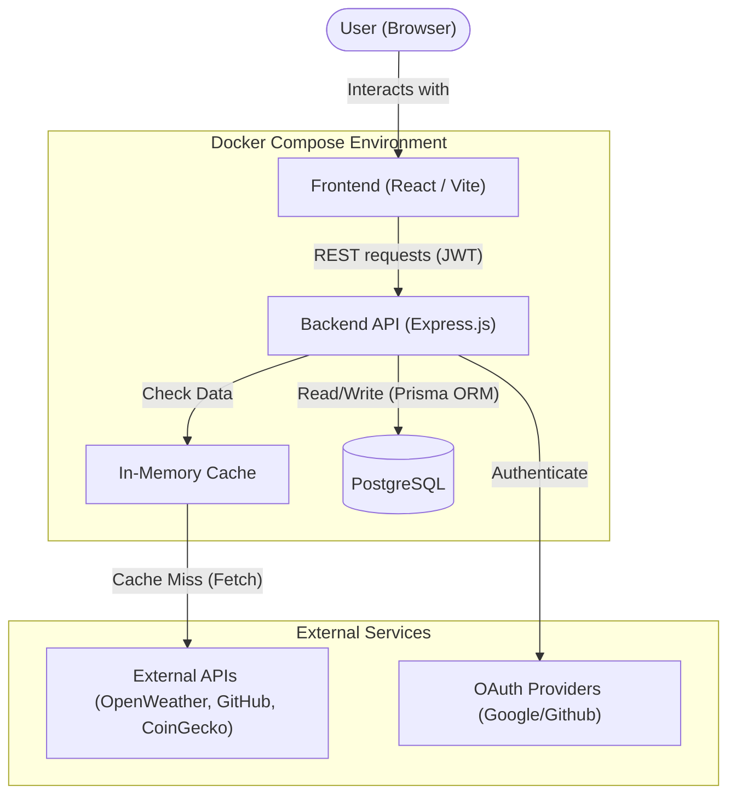

# System Architecture

## Overview

The Dashboard follows a modern decoupled architecture. The frontend and backend run in isolated Docker containers, communicating via a REST API. External API calls are routed through the backend to protect API keys and prevent rate-limiting via a caching layer.

## Architecture Diagram

## Core Components

### 1. Frontend (Client)

- **Framework**: React via Vite.
- **Role**: Renders the drag-and-drop grid (`react-grid-layout`) and handles user interactions.
- **State**: Manages widget configurations, OAuth states, and user sessions.
- **Widgets**: Uses a custom `useWidgetTimer` hook embedded in `WidgetRenderer` to independently auto-refresh widget data based on the database `refreshRate`. Crypto comparison widgets render normalized SVG curves without a charting dependency.

### 2. Backend (Server)

- **Framework**: Node.js with Express.
- **Role**: Acts as the central orchestrator.
    - Handles Authentication (`/auth/login`, `/auth/register`).
    - Stores and verifies user-owned service connections (`/services`).
    - Serves the dynamic Service Registry (`/about.json`).
    - Proxies widget requests to external APIs.

### 3. Caching Layer

- **Role**: Sits inside the Backend container. Intercepts outgoing requests to external APIs. Weather and CoinGecko cache entries are scoped to the authenticated user's service connection and expire according to the widget refresh interval, capped at five minutes.

### 4. Database

- **Engine**: PostgreSQL 15.
- **Role**: Persistent storage for User accounts, OAuth tokens, encrypted service connections, and Widget configurations (position, refresh rates, parameters).
