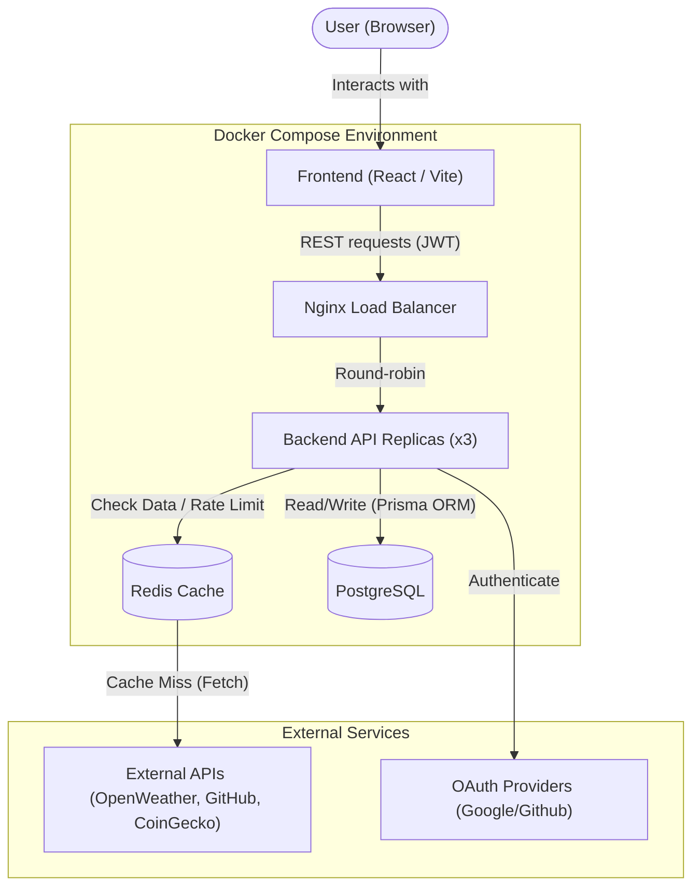

# System Architecture

## Overview

The Dashboard follows a modern decoupled architecture. The frontend and backend run in isolated Docker containers, communicating via a REST API. External API calls are routed through the backend to protect API keys and prevent rate-limiting via a caching layer.

## Architecture Diagram

## Core Components

### 1. Frontend (Client)

- **Framework**: React via Vite.
- **Role**: Renders the drag-and-drop grid (`react-grid-layout`) and handles user interactions.
- **State**: Manages widget configurations, OAuth states, and user sessions.
- **Widgets**: `WidgetRenderer` fetches each widget's data with TanStack Query; `refetchInterval` follows the widget's `refreshRate`, so widgets refresh independently. Crypto comparison widgets render normalized SVG curves without a charting dependency.
- **API access**: All requests go through `src/lib/apiClient.ts`, which attaches the JWT and turns error responses into exceptions.
- **Source layout** (`frontend/src/`):
    - `pages/`: one component per route.
    - `features/<feature>/`: code owned by one feature, split into `components/`, `hooks/` and `lib/`. `features/widgets/catalog/` holds the per-service widget UIs referenced by `lib/registry.tsx`.
    - `components/`: the app shell shared by every page (`Navbar`, `ErrorBoundary`, `ThemeProvider`, `CookieBanner`) and the `ui/` primitives from shadcn.
    - `lib/`: cross-feature helpers (`apiClient`, `auth`, `utils`).

### 2. Backend (Server)

- **Framework**: Node.js with Express.
- **Role**: Acts as the central orchestrator running as 3 scaled replicas.
    - Handles Authentication (`/auth/login`, `/auth/register`).
    - Stores and verifies user-owned service connections (`/services`).
    - Serves the dynamic Service Registry (`/about.json`).
    - Proxies widget requests to external APIs.
- **Source layout** (`backend/`):
    - `routes/`: Express routers; they only map paths and middleware to controllers.
    - `controllers/`: request handlers (`auth`, `githubAuth`, `account` for GDPR, `widgets`, `services`, `admin`, `chatbot`, `health`), wrapped in `asyncHandler` so errors reach `middleware/errorHandler.js`.
    - `services/`: one module per external provider (weather, crypto, github, youtube, chatbot), `githubIdentity` for GitHub login, and the `registry` behind `/about.json`.
    - `middleware/`: authentication, admin check, error handler.
    - `utils/`: the shared `PrismaClient` (`prisma.js`), environment validation (`env.js`), JWT helpers (`authToken.js`), encryption (`encryption.js` for widget parameters and credentials, `tokenEncryption.js` for OAuth tokens) and the Redis cache.

### 3. Caching & Load Balancing

- **Load Balancer**: Nginx routes incoming API requests across the 3 backend replicas using dynamic Docker DNS resolution.
- **Redis Cache**: A centralized Redis container manages widget data caching, the authentication rate limiter (`rate-limit-redis`, shared by all replicas), and transient OAuth states. The global request limiter is kept in memory per replica. Cache entries expire according to the widget refresh interval, capped at five minutes.

### 4. Shared Package

- The `shared` workspace exports Zod schemas (register, login, profile update) and TypeScript types. The backend validates requests with them and the frontend imports the matching types, so both sides follow one contract.

### 5. Database

- **Engine**: PostgreSQL 15.
- **Role**: Persistent storage for User accounts, OAuth tokens, encrypted service connections, and Widget configurations (position, refresh rates, parameters).
