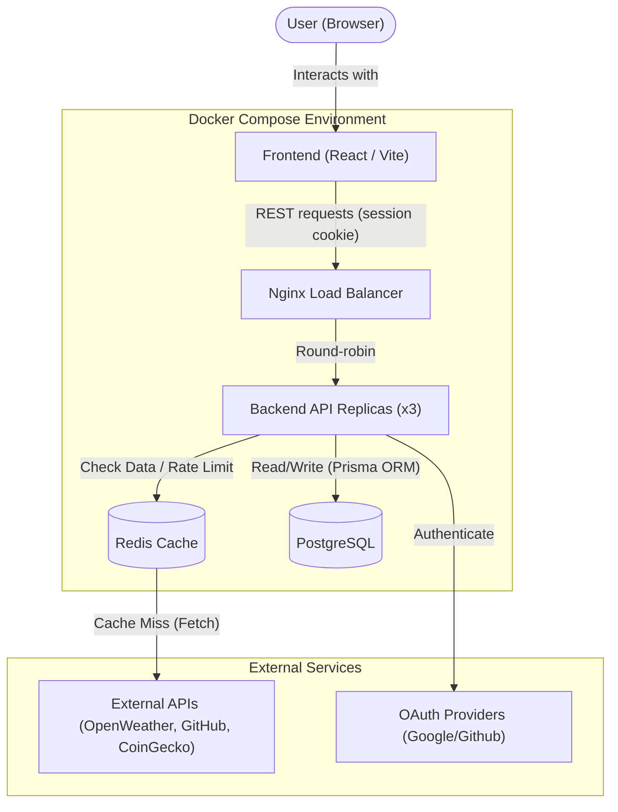

# System Architecture

## Overview

The Dashboard follows a modern decoupled architecture. The frontend and backend run in isolated Docker containers, communicating via a REST API. External API calls are routed through the backend to protect API keys and prevent rate-limiting via a caching layer.

## Architecture Diagram

## Core Components

### 1. Frontend (Client)

- **Framework**: React via Vite.
- **Role**: Renders the drag-and-drop grid (`react-grid-layout`) and handles user interactions.
- **State**: Manages widget configurations, OAuth states, and user sessions.
- **Widgets**: `WidgetRenderer` fetches each widget's data with TanStack Query; `refetchInterval` follows the widget's `refreshRate`, so widgets refresh independently. Crypto comparison widgets render normalized SVG curves without a charting dependency.
- **API access**: Requests to the project's routes go through `src/lib/apiClient.ts`, which sends credentials and turns error responses into exceptions; authentication goes through Better Auth's client (`src/lib/auth.ts`).
- **Session**: Better Auth keeps the session in an httpOnly cookie that page scripts cannot read, backed by a revocable row in PostgreSQL. `useCurrentUser` (`GET /api/auth/get-session`) tells whether the visitor is signed in, and protected routes wait for it. Writes authenticated by the cookie must come from an allowed origin (Better Auth on `/api/auth/*`, `middleware/auth.ts` on the other routes).
- **Source layout** (`frontend/src/`):
    - `pages/`: one component per route.
    - `features/<feature>/`: code owned by one feature, split into `components/`, `hooks/` and `lib/`. `features/widgets/catalog/` holds the per-service widget UIs referenced by `lib/registry.tsx`; each declares the response type of its backend service, and `lib/types.ts` types the registry.
    - `components/`: the app shell shared by every page (`Navbar`, `ErrorBoundary`, `ThemeProvider`, `CookieBanner`) and the `ui/` primitives from shadcn.
    - `lib/`: cross-feature helpers (`apiClient`, `auth`, `utils`).

### 2. Backend (Server)

- **Framework**: Node.js with Express, written in TypeScript. Node runs the `.ts` sources directly; `tsc` type-checks them in CI.
- **Role**: Acts as the central orchestrator running as 3 scaled replicas.
    - Handles authentication with [Better Auth](https://www.better-auth.com) (`src/auth.ts`, served under `/api/auth/*`): email/password, GitHub sign-in and linking, sessions, administration (admin plugin). The project adds the CGU and age checks at sign-up.
    - Stores and verifies user-owned service connections (`/services`).
    - Serves the dynamic Service Registry (`/about.json`).
    - Proxies widget requests to external APIs.
- **Source layout** (`backend/src/`):
    - `routes/`: Express routers; they only map paths and middleware to controllers.
    - `auth.ts`: the Better Auth configuration and the project's sign-up rules.
    - `controllers/`: request handlers (`account` for GDPR export and profile, `widgets`, `services`, `chatbot`, `health`), wrapped in `asyncHandler` so errors reach `middleware/errorHandler.ts`.
    - `services/`: one module per external provider (weather, crypto, github, youtube, chatbot) and the `registry` behind `/about.json`.
    - `middleware/`: session check (`requireAuth`, through Better Auth) and error handler.
    - `utils/`: the shared `PrismaClient` (`prisma.ts`), environment validation (`env.ts`), encryption at rest of widget params and API keys (`encryption.ts`), linked OAuth tokens (`oauthAccounts.ts`) and the Redis cache.

### 3. Caching & Load Balancing

- **Load Balancer**: Nginx routes incoming API requests across the 3 backend replicas using dynamic Docker DNS resolution.
- **Redis Cache**: A centralized Redis container manages widget data caching, the rate limit counters (global and authentication, shared by all replicas through `utils/rateLimit.ts`), and transient OAuth states. If Redis is unreachable, the cache falls back to memory and rate limiting is skipped rather than blocking requests. Cache entries expire according to the widget refresh interval, capped at five minutes.

### 4. Shared Package

- The `shared` workspace exports Zod schemas (register, login, profile update) and TypeScript types. The backend validates requests with them and the frontend imports the matching types, so both sides follow one contract.

### 5. Database

- **Engine**: PostgreSQL 15.
- **Role**: Persistent storage for User accounts, OAuth tokens, encrypted service connections, and Widget configurations (position, refresh rates, parameters).
