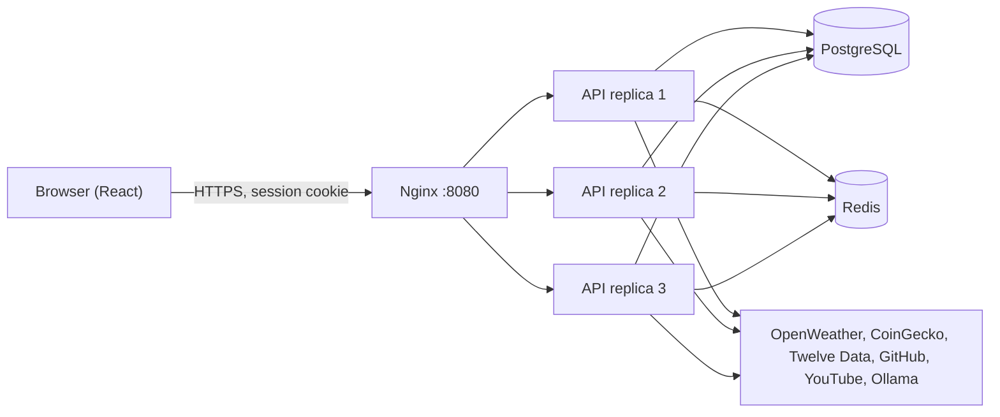

# How it works

Short answers to "how does X work?", with the files to open if a question goes deeper.

## The big picture

Widget data goes through our API, which holds the keys, checks the user, caches answers
and returns what the widget shows. YouTube thumbnails and the clicked video player load
directly in the browser.

## Widgets

### What is a widget?

A row in the `WidgetConfig` table: a service (`weather`), a widget (`current_weather`), its
params (`{ "city": "Paris" }`, encrypted), a refresh rate in seconds and a position on the grid.
Two widgets of the same type with different params show different data: each one is its own row.

### How does the refresh rate work?

1. The user chooses it when adding the widget (minimum **60 s**; the API refuses less).
2. The frontend asks `GET /widgets/:id/data` again every `refreshRate` seconds
   (`refetchInterval` of TanStack Query, `WidgetRenderer.tsx`). The previous data stays on
   screen while the new one loads.
3. The backend caches each answer for the refresh rate, **between 1 and 5 minutes**
   (`widgetCacheTtl`, `utils/redisCache.ts`). A refresh inside that time is served from Redis
   without calling the provider.

Why cap the cache at 5 minutes: a widget refreshed every hour still shows data at most
5 minutes old when the page is reopened. Why a 60 s minimum: providers' free plans allow few
calls per minute.

### What happens when a widget loads?

`GET /widgets/:id/data` (`controllers/widgets.ts`):

1. Session checked (cookie), widget found, and it must belong to this user (`403` otherwise).
2. Params decrypted.
3. The service's credentials are found: the user's API key (decrypted), or the token of the
   chosen GitHub account (refreshed by Better Auth if expired).
4. `service.execute()` checks the params, then reads the cache or calls the provider.
5. The answer is reduced to what the widget needs and returned. Provider errors become clear
   codes (`CITY_NOT_FOUND`, `WEATHER_RATE_LIMIT`…) that the frontend translates.

### Two widgets ask for the same data at the same moment?

`cached()` (`utils/redisCache.ts`) runs only one provider call per key: the second request
waits for the first and gets the same answer. A failed call is not cached; the next request
tries again.

### How does the "Add widget" form know the widgets and their params?

It reads `GET /about.json`, the list required by the subject (services, widgets, params and
types), built from the backend registry (`services/registry.ts`). The frontend registry
(`features/widgets/lib/registry.tsx`) only says how to display each widget and field. A widget
added to the backend appears in the form as soon as the frontend has a component for it.

### How are positions saved?

Drag or resize, then 0.5 s without moving: `PUT /widgets/layout` saves every position in one
request (`useWidgetLayoutManager.ts`). Only the desktop layout is saved; phones and tablets
rearrange it automatically. With the keyboard, each arrow press saves at once.

## Services and accounts

### How is an API key connected?

Services page → paste the key → the API **tests it** with a real call to the provider → if it
works, it is encrypted (AES-256-GCM) and stored; only the last 4 characters are kept readable to
show which key it is. The key never goes back to the browser.

### How does GitHub work with several accounts?

Two different GitHub uses:

- **Sign in with GitHub** (`github` provider): identity only, no access to repositories.
- **GitHub service** (`github-service` provider): "Connect a GitHub account" on the Services
  page, with the `repo` scope. A user can connect several accounts and choose one per widget.
  Tokens are encrypted and refreshed by Better Auth; these accounts can never be used to sign in.

### YouTube has no key?

It reads the channels' public RSS feeds (`youtubeFeed.ts`) and the video player loads from
`youtube-nocookie.com` only on click. Feeds are cached 10 minutes and shared between users.

### Stocks and the provider quota?

Twelve Data's free plan allows 8 credits a minute (1 credit per symbol). The service counts the
credits left for each key, asks only for symbols not already cached, and answers `429` with a
wait time when the budget is spent: the widget keeps the data already loaded and retries by
itself (`stockProvider.ts`).

## Accounts and security

### How does sign-up work?

Email, password (8 to 128 characters), terms accepted and age ≥ 16 → a **6-digit code** is
emailed (valid 5 minutes, 3 tries, stored hashed) → entering it verifies the email and signs
in. GitHub sign-up needs a verified GitHub email.

### How is the user kept signed in?

A **session** stored in PostgreSQL, referenced by an `httpOnly` cookie (`dashboard.session_token`):
JavaScript cannot read it, so an injected script cannot steal it. It lasts 7 days and is extended
while in use. Signing out, a ban or a deletion revokes it at once.

### What stops attacks?

| Attack                        | Protection                                                            |
| ----------------------------- | --------------------------------------------------------------------- |
| Password guessing             | 20 sign-in or code attempts per IP per 15 min, shared by all replicas |
| Request from another site     | `Origin` checked on every write (CSRF); CORS limited to our frontend  |
| Reading another user's widget | Each request checks the owner (`403`)                                 |
| Stolen database               | Passwords hashed (scrypt), keys and tokens encrypted (AES-256-GCM)    |
| Script injection              | React escapes text; Content-Security-Policy; Helmet headers           |
| Flooding the API              | 1000 requests per IP per 15 min                                       |

### Forgotten password?

A code by email, then a new password; every session is signed out. The answer is the same
whether the email exists or not, so nobody can test which emails have an account.

### What can an administrator do?

`/admin`: list and search accounts, make or remove administrators, sign a user out everywhere,
ban (with a reason, for 1, 7, 30 days or until lifted) and delete. An administrator cannot
change their own role or ban or delete themselves.

### GDPR?

From the account menu: download all your data (JSON, without passwords or keys) or delete the
account and everything it owns. See [RGPD.md](RGPD.md).

## Running

### Why 3 API replicas behind Nginx?

Nginx spreads requests over 3 identical containers; one can crash without stopping the API.
They share nothing in memory: sessions are in PostgreSQL, cache and rate limits in Redis.

### What if Redis goes down?

The cache falls back to the memory of each replica, and rate limiting is skipped. The API keeps
answering.

### What happens at startup?

The `init` service first generates a stable secret in `auth_data` if none exists. The
Docker launcher uses that shared secret when `BETTER_AUTH_SECRET` is unset and routes
mail to the local Mailpit inbox when `SMTP_HOST` is empty. Each replica applies the database migrations (Prisma takes a lock, so only one does it), then
creates the demo accounts if missing (`SEED_DEMO_DATA`, a database lock again), then listens on 8080.

### How do languages work?

French and English (`frontend/src/i18n/locales`). The choice is saved in the browser; first
visit follows the browser language. Errors come from the API as codes, translated by the
frontend, so the API stays language-independent.

### And accessibility?

Text up to 200 %, high contrast, reduced motion, keyboard moves for widgets, screen reader
labels and announcements. See [accessibility.md](accessibility.md).
