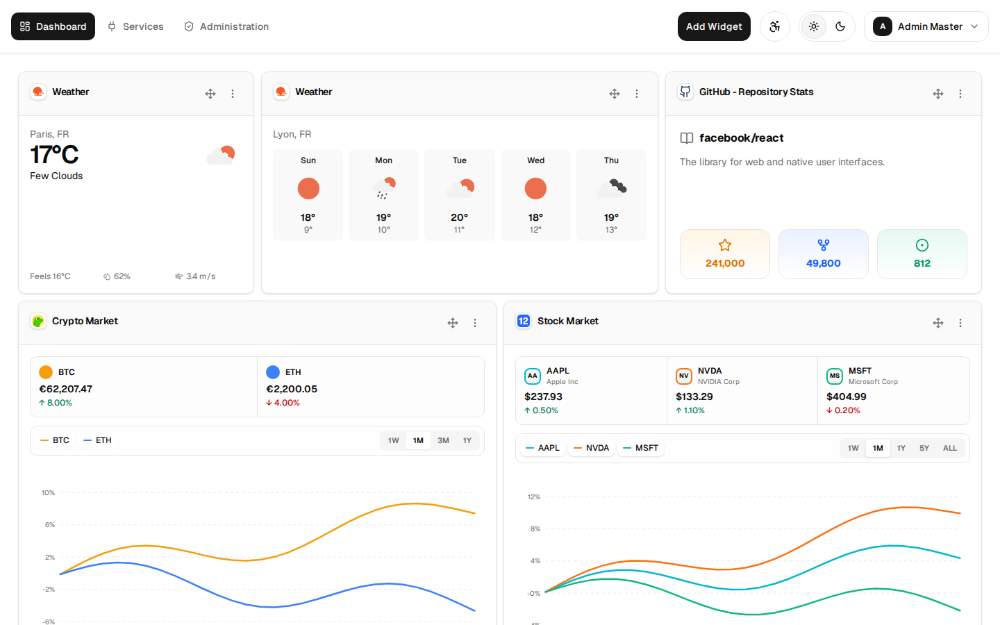
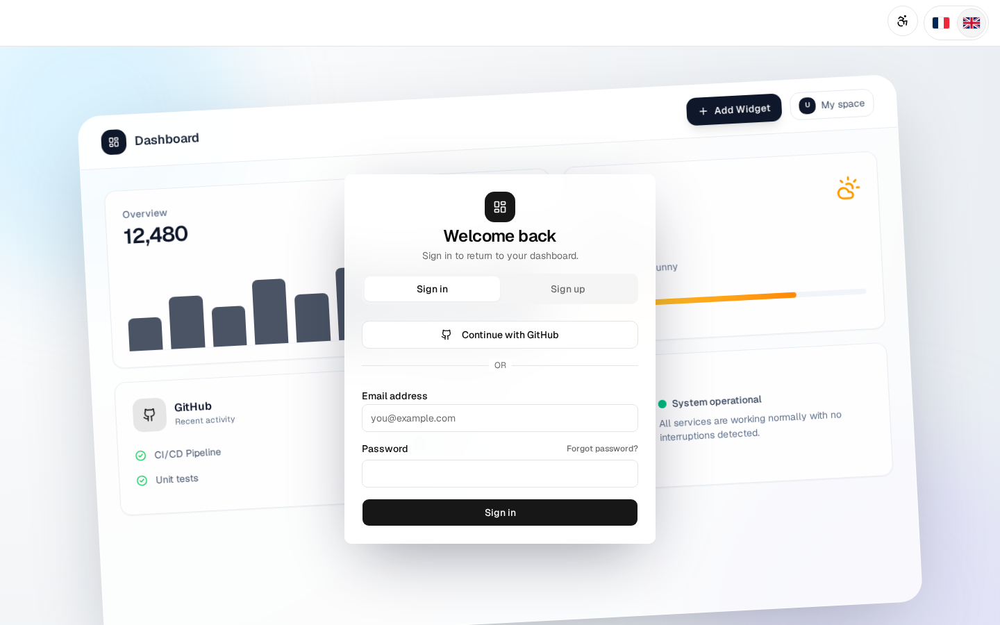
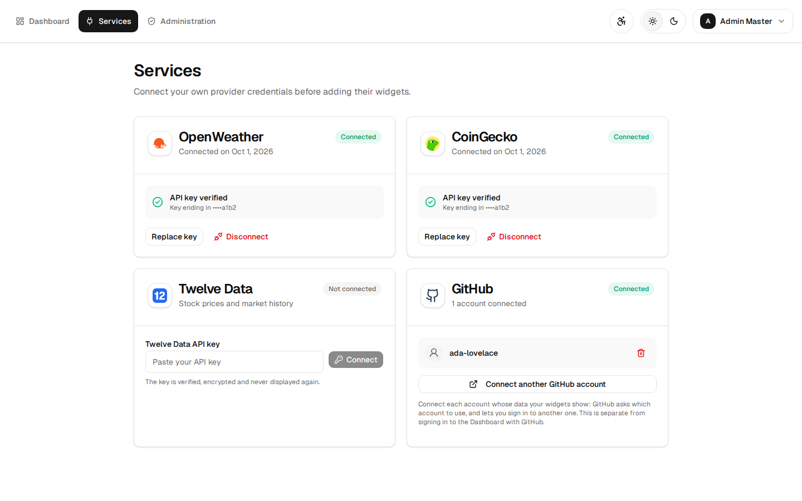
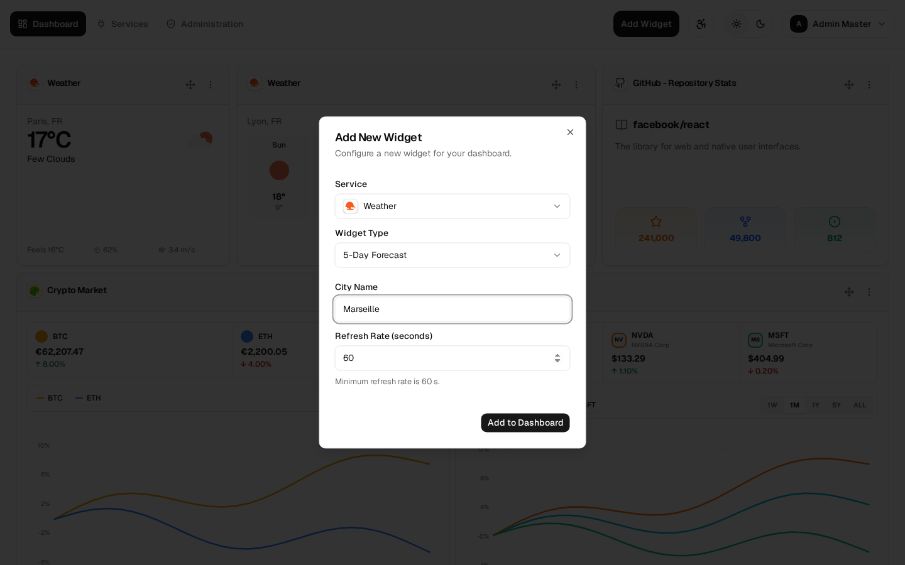
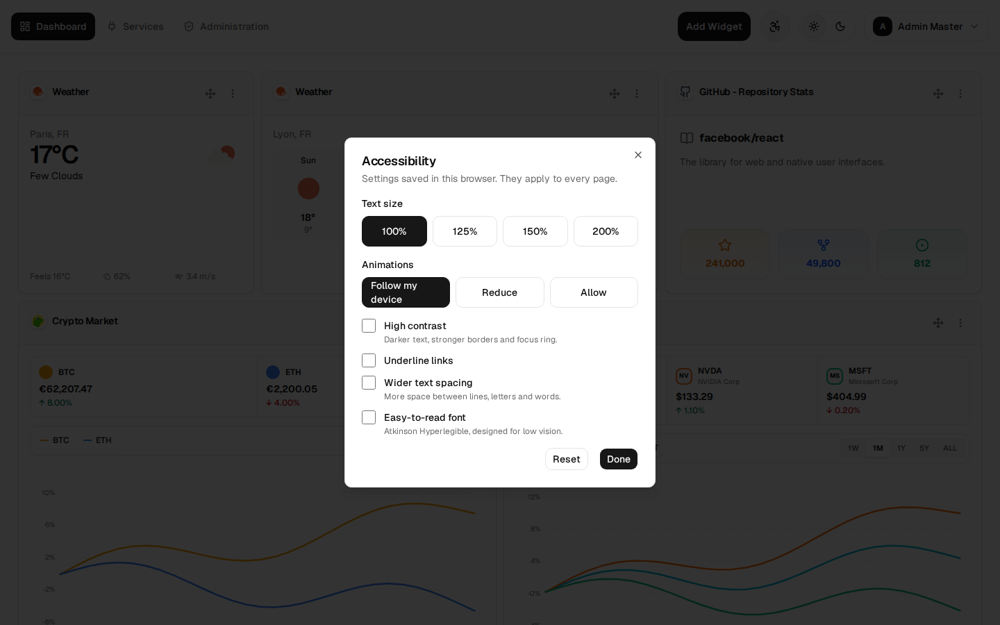
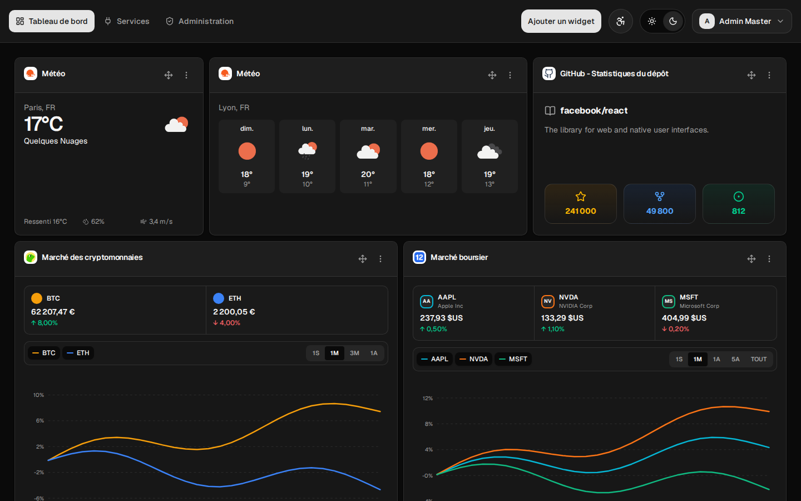
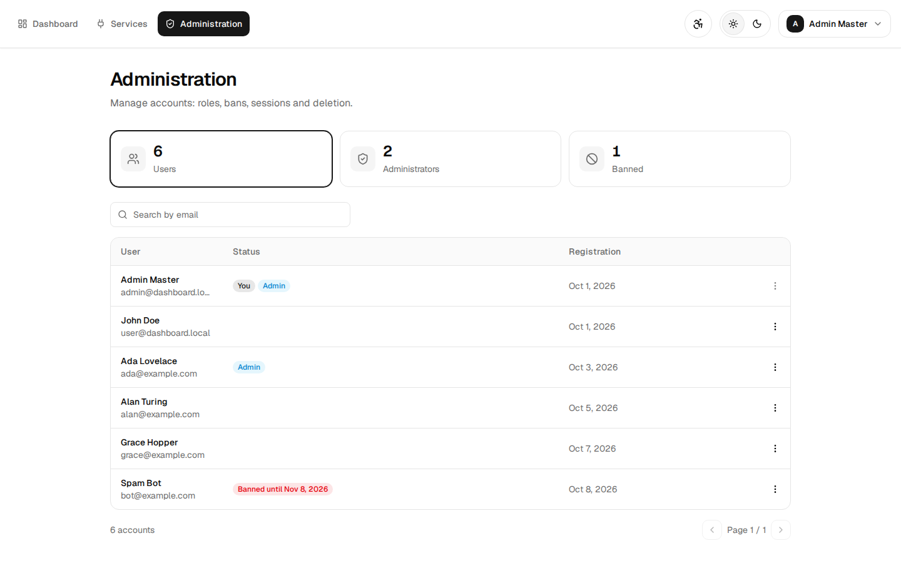

# User guide

## What is the Dashboard?

A web page where each user builds their own dashboard from **widgets**: the weather in a city,
GitHub repository stats, crypto and stock prices, YouTube videos, a local AI chat. Each widget
refreshes by itself, can be moved and resized on a grid, and can appear several times with
different settings (the weather in Paris and in Lyon).



## Run it

Requirements: Docker with Docker Compose. Node.js 24 only to run it outside Docker.

```bash
cp -n backend/.env.example backend/.env   # then set BETTER_AUTH_SECRET (openssl rand -hex 32)
docker compose up --build
```

| What           | Address                                                            |
| -------------- | ------------------------------------------------------------------ |
| Application    | [http://localhost:8081](http://localhost:8081)                     |
| API            | [http://localhost:8080](http://localhost:8080)                     |
| `about.json`   | [http://localhost:8080/about.json](http://localhost:8080/about.json) |
| API reference  | [http://localhost:8080/api-docs](http://localhost:8080/api-docs)   |

Two demo accounts are created at startup:

| Account        | Email                   | Password    |
| -------------- | ----------------------- | ----------- |
| Administrator  | `admin@dashboard.local` | `admin1234` |
| User           | `user@dashboard.local`  | `user1234`  |

Optional settings in `backend/.env`: `SMTP_*` to send the sign-up codes by email, and
`GITHUB_CLIENT_ID` / `GITHUB_CLIENT_SECRET` for GitHub sign-in and the GitHub widgets. The
[README](../README.md#installation--usage) explains each variable and how to run without
Docker.

## Use it

### 1. Sign in

Email and password, or **Sign in with GitHub**. A new account receives a 6-digit code by email
to confirm the address. Forgotten password: a code by email too.



### 2. Connect services

**Services** page. Weather, crypto and stocks need a free API key from the provider: paste it,
the Dashboard tests it, then stores it encrypted. GitHub connects with a button (OAuth), and
several GitHub accounts can be connected. YouTube and the chatbot need nothing.



### 3. Add widgets

**Add Widget**: choose a service, a widget, fill its settings and a refresh rate (60 s
minimum). A service that is not connected yet is shown with a link to the Services page.



### 4. Arrange the dashboard

- **Mouse**: drag a widget to move it, resize it from its bottom-right corner.
- **Keyboard**: focus the move button (four arrows), arrows move it, `Shift` + arrows resize it.
- **Menu** (three dots): edit the settings or delete the widget.

Positions are saved automatically. On a phone the widgets stack in one column.

### 5. Preferences

From the navigation bar: light or dark theme, language (English / French), and the
**accessibility** menu (text up to 200 %, high contrast, reduced animations, underlined links,
wider spacing, easy-to-read font). See [accessibility.md](accessibility.md).





### 6. Account

Account menu (name, top right): download all your data (JSON), delete the account, sign out.

### 7. Administration

Administrators see an **Administration** page: search accounts, make or remove
administrators, sign a user out everywhere, ban (with a reason and a duration) or delete.



## Services and widgets

6 services, 12 widgets. The full list with their parameters is in `about.json`.

| Service     | Provider                   | Connection          | Widgets                                                        |
| ----------- | -------------------------- | ------------------- | -------------------------------------------------------------- |
| Weather     | OpenWeather                | API key             | **Current Temperature** (city), **5-Day Forecast** (city)      |
| GitHub      | GitHub API                 | OAuth, many accounts | **Repository Stats**, **Latest Commits** (branch), **User Profile** |
| Crypto      | CoinGecko                  | API key             | **Price & Market Stats** (one coin), **Market Comparison Chart** (up to 8 coins, 1W to 1Y) |
| Stocks      | Twelve Data                | API key             | **Stock Market** (up to 8 stocks compared), **Stock Profile** (one company, 1W to ALL) |
| YouTube     | Public RSS feeds           | None                | **Video Player** (a video link), **Channel Watch** (up to 5 channels) |
| Chatbot     | Ollama (runs locally)      | None                | **Ollama Chat** (choose or download a model)                   |

Free keys: [OpenWeather](https://home.openweathermap.org/api_keys),
[CoinGecko](https://www.coingecko.com/en/developers/dashboard),
[Twelve Data](https://twelvedata.com/account/api-keys).

## Stack

| Part           | Technology                                                                                          |
| -------------- | --------------------------------------------------------------------------------------------------- |
| Frontend       | [React](https://react.dev), [Vite](https://vite.dev), [Tailwind CSS](https://tailwindcss.com), [shadcn/ui](https://ui.shadcn.com), [TanStack Query](https://tanstack.com/query), [react-grid-layout](https://github.com/react-grid-layout/react-grid-layout), [i18next](https://www.i18next.com) |
| Backend        | [Node.js](https://nodejs.org), [Express](https://expressjs.com), [Better Auth](https://www.better-auth.com), [Zod](https://zod.dev) |
| Data           | [PostgreSQL](https://www.postgresql.org), [Prisma](https://www.prisma.io), [Redis](https://redis.io) |
| Infrastructure | [Docker Compose](https://docs.docker.com/compose/), [Nginx](https://nginx.org) (3 API replicas), [Ollama](https://ollama.com) |
| Tests          | [Vitest](https://vitest.dev), [Playwright](https://playwright.dev), [axe](https://github.com/dequelabs/axe-core), [Lighthouse CI](https://github.com/GoogleChrome/lighthouse-ci) |

Why these choices: [tech_stack.md](tech_stack.md). How things work inside:
[how-it-works.md](how-it-works.md).

## Screenshots

The images above come from `node e2e/scripts/screenshots.mjs` (dev servers running, demo
admin account). Widget data and service states are fixed examples, so no provider key is needed.
